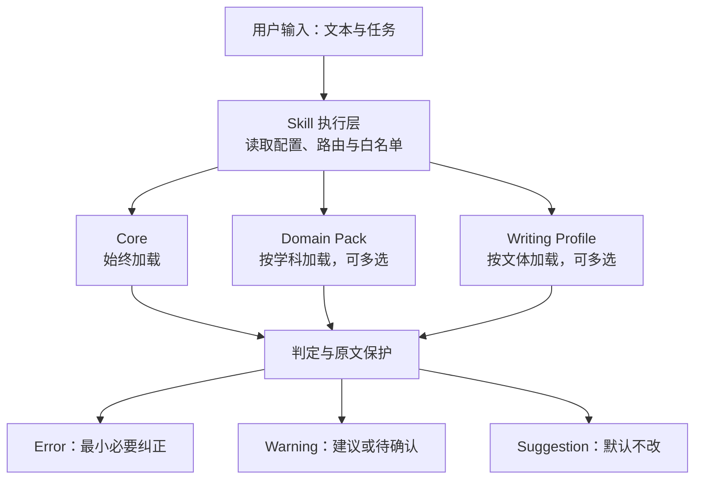

<div align="center">

<h1>中文受控语言规范</h1>
<p><strong>Chinese Controlled Language</strong></p>

<p>面向科研与工程技术交流的中文受控语言规范与 Agent Skill 实现。</p>
<p><strong>规范表达，而不是限制表达。</strong><br>纠正真实语言问题，保护科学含义、技术事实与结论边界。</p>

<p>
  <a href="https://github.com/lanhongxiang-firefly/zh-controlled-language"></a>
  <a href="https://github.com/lanhongxiang-firefly/zh-controlled-language/blob/main/core/language-rules.md"></a>
  <a href="https://creativecommons.org/licenses/by/4.0/"></a>
  <a href="LICENSE"></a>
</p>

</div>

## 导航

[项目定位](#project) · [核心原则](#principles) · [工作方式](#workflow) · [架构](#architecture) · [快速开始](#quick-start) · [测试与验证](#validation) · [扩展与贡献](#contributing) · [文档](#documentation) · [许可证](#license)

<a id="project"></a>
## 项目定位

中文受控语言规范（Chinese Controlled Language）是一套面向科研与工程技术交流的中文表达规则，并提供按 Agent Skills 结构组织的执行层。它关注表达是否准确、清晰，以及改写是否保留原文中的科学含义和技术信息。

项目借鉴 ASD-STE100 的受控语言思想，并根据中文科研与工程技术写作场景独立制定规则。本项目不声明符合或通过 ASD-STE100 认证，也不替代该规范。

项目希望解决的不是「所有人都用同一种写法」，而是以下问题：

- 明确的语言、术语或语义错误没有得到纠正。
- 润色时改变了技术事实、因果关系、证据强度或结论边界。
- 为追求风格统一，替换了有依据或在文献中实际使用的术语词形。
- 通用写作规则被机械套用到不同学科、文体和交流场景。

### 适用文本

代码注释、技术文档、科研申请书、技术报告、项目材料、日志与错误提示、日常技术交流。具体适用强度由文体 Profile 决定；日常专业交流默认只执行 Core 的 Error 级规则。

### 当前提供的学科扩展

| Domain Pack | 目录 | 状态 |
| --- | --- | --- |
| 工程热物理（Engineering Thermophysics） | [domains/engineering-thermophysics/](domains/engineering-thermophysics/) | 当前仓库提供的首个 Pack；Core 版本要求为 `0.2` |

<a id="principles"></a>
## 核心原则

1. **保护原文含义。** 科学含义、技术事实、公式、符号、数值、限定条件、证据强度和结论边界均属于保护对象。
2. **只纠正真实问题。** 原文准确、自然、简洁时，不为展示规则或追求统一而改写。
3. **按证据管理术语。** 术语的强制性必须有依据；存在争议或依据不足时，保留原词并标记待确认。
4. **按需加载规则。** Core 始终加载；学科 Pack 与文体 Profile 根据任务配置加载，不把未加载模块中的规则用于当前判定。
5. **最小必要修改。** 发现明确错误时，只修改消除该错误所必需的部分，不额外改写无关内容。

本项目不设置句长、段落长度、标题层级、清单项数或连接词数量等机械阈值；不把长句、被动句、多重定语或多重否定本身视为错误。

<a id="workflow"></a>
## 工作方式

### 规则分级

| 级别 | 含义 | 默认处置 |
| --- | --- | --- |
| **Error** | 明确的语言、术语或语义错误，且可能影响事实、逻辑或科学含义 | 必须纠正，只作最小改动 |
| **Warning** | 可能影响清晰度、自然度或一致性的表达问题 | 提供建议；语境不足时标记待确认，不强制改写 |
| **Suggestion** | 文体、结构或表达偏好 | 默认不改，由文体和读者决定 |

### 判定与冲突处理

- 先确认文本是否属于保留项或正确表达，再判断 Error、Warning；Suggestion 默认不改。
- 术语只有同时满足「状态为 `Accepted`、具有有效依据、级别为 `Error`」三个条件，才可作为强制规则。
- 多个 Pack 的术语定义或适用语境冲突时，保留各自词形与上下文，标记待确认，不强制统一。
- 规则依据缺失、术语状态为 `Proposed` 或 `Disputed` 时，不创造译法，也不升级为强制规则。
- 用户未配置默认学科且未指定 Pack 时，只加载 Core，不推断专业术语规范。

### 示例：保护证据强度

原文：

> 结果偏差可能是设备问题导致的。

不允许的改写：

> 结果偏差是设备问题导致的。

正确处置：保留「可能」。原句表达的是推测，删除该限定词会把不确定判断改成确定结论。这属于 Core 的 Error 级规则 E5「证据强度」。

更多规则与校准案例见 [Core 语言规则](core/language-rules.md) 和 [原文保护与质量控制](core/quality-control.md)。

<a id="architecture"></a>
## 架构

项目采用四层结构。Core、Domain Pack 与 Writing Profile 是规则模块；Skill 执行层负责读取配置、路由模块和执行判定。



| 层 | 负责 | 不负责 |
| --- | --- | --- |
| **Core** | 通用中文表达规则、术语治理机制、分级、误判控制与原文保护 | 学科专属术语表、文体模板 |
| **Domain Pack** | 学科术语、依据、学科特有规则与本学科测试用例 | 重复定义通用规则、管理其他学科内容 |
| **Writing Profile** | 按文体调整适用强度与表达偏好 | 定义术语、译法或学科约束 |
| **Skill 执行层** | 配置读取、模块加载、白名单路由、冲突处置与按需审查记录 | 重新定义规则正文 |

Core 规则与术语治理机制见 [core/](core/)；模块接口和状态约定见 [pack-interface.md](docs/architecture/pack-interface.md)。

<a id="quick-start"></a>
## 快速开始

### 环境要求

- Python 3。
- 安装与测试脚本使用 Python 标准库，不需要额外安装第三方 Python 包。
- 以下安装脚本会向本机四个 Agent 宿主的用户级技能目录写入文件；执行前请确认目标目录和本机配置。

### 获取仓库并安装

```bash
git clone https://github.com/lanhongxiang-firefly/zh-controlled-language.git
cd zh-controlled-language
python install_skills.py
```

安装脚本当前会部署到以下目录：

| 宿主 | 用户级技能目录 |
| --- | --- |
| WorkBuddy | `~/.workbuddy/skills/engineering-thermophysics-zh-controlled-language/` |
| Codex | `~/.codex/skills/engineering-thermophysics-zh-controlled-language/` |
| DeepSeek Harness | `${DSH_HOME:-~/.dsh}/skills/engineering-thermophysics-zh-controlled-language/` |
| Claude Code | `~/.claude/skills/engineering-thermophysics-zh-controlled-language/` |

### 安装脚本会执行什么

1. 组装公开技能包到 `build/zh-controlled-language/`；公开包的 `defaults.yaml` 不预设学科。
2. 将技能文件部署到上表中的四个宿主目录。
3. 本机安装副本当前写入 `default_domain: engineering-thermophysics`。
4. 若目标目录已存在，先将原目录备份到仓库的 `backup/`；原目录中的 `references/` 和 `tests/` 会移入 `_v0.2_archive/`，脚本不主动删除这些文件。

当前安装脚本会处理全部四个宿主，没有单宿主选择参数。若需使用其他默认学科，请在部署后的技能目录中检查并修改 `defaults.yaml`；再次运行安装脚本时，本机默认值会按脚本配置重新写入。

技能规范名为 `zh-controlled-language`。四个宿主的安装目录保留旧名 `engineering-thermophysics-zh-controlled-language` 作为兼容别名，详见 [skill/ALIASES.md](skill/ALIASES.md)。

<a id="validation"></a>
## 测试与验证

### 当前构造用例结果

截至 2026-11-11，仓库包含 28 条构造用例。当前登记的观测结果由规则制定方自评，不是独立盲评，也不是对大语言模型的自动化基准测试。

| 测试组 | 正例 | 反例 | 边界例 | 合计 | 已登记误判 |
| --- | ---: | ---: | ---: | ---: | ---: |
| Core | 8 | 6 | 5 | 19 | 0 |
| Engineering Thermophysics Pack | 1 | 2 | 3 | 6 | 0 |
| Integration | 1 | 0 | 2 | 3 | 0 |
| **合计** | **10** | **8** | **10** | **28** | **0** |

此外，跨学科模拟检查的 6 项断言均通过。各组观测记录见 [Core](core/RESULTS.md)、[Domain Pack](domains/engineering-thermophysics/tests/RESULTS.md) 和 [Integration](tests/RESULTS.md)。

### 运行结构与回归检查

```bash
python tests/run_tests.py --integration --strict
```

该执行器检查用例结构，并将 `results.json` 中预先登记的观测处置与期望处置进行比较，统计过度修改、漏判和分级误判。它不调用大语言模型，不独立产生模型判断，也不测量阅读效率或理解正确率。因此，当前的「0 误判」只能表述为：**现有自评观测记录与用例期望一致**。

维护者本机迁移检查：

```bash
python tests/verify_migration.py
```

该脚本检查公开包、zip、备份目录及四个宿主安装副本的一致性。它依赖维护者本机的构建产物和安装环境，不是面向干净环境的通用测试命令。

### 独立盲评与真实语料

仓库已提供盲评材料生成、评审表、结果汇总脚本和真实项目文本登记协议。生成材料的命令为：

```bash
python tests/blind-review/generate_materials.py
```

截至上述日期，尚无独立评审方提交的观测文件，真实项目文本语料也尚未建立。因此，独立盲评和真实语料测试**尚未执行**。测试框架检验的是规则判定一致性，不等同于模型效果、阅读效率或技术理解能力的验证。详见 [独立盲评协议](tests/blind-review/protocol.md) 与 [真实语料登记规范](tests/blind-review/real-corpus.md)。

<a id="contributing"></a>
## 扩展与贡献

新增学科时，按 Domain Pack 接口创建独立目录，登记术语依据、规则和正例／反例／边界用例。新增 Pack 原则上不修改 Core、其他 Pack、Writing Profile 或 Skill 执行层。

- [贡献指南](CONTRIBUTING.md)：最小贡献流程与基本约束。
- [详细贡献流程](docs/architecture/CONTRIBUTING.md)：审核门槛与 Pull Request 模板。
- [模块接口](docs/architecture/pack-interface.md)：manifest、术语条目、状态机、测试格式与加载契约。

术语状态采用 `Proposed`、`Accepted`、`Deprecated`、`Disputed`。未经可靠依据支持的条目不得升级为强制规则；术语冲突应保留上下文，不强制统一。

<a id="documentation"></a>
## 文档

| 文档 | 内容 |
| --- | --- |
| [Core 语言规则](core/language-rules.md) | 通用表达规则、分级、误判控制与表达问题词形 |
| [术语治理机制](core/terminology-governance.md) | 术语分层、依据类别、状态机与强制规则门槛 |
| [质量控制](core/quality-control.md) | 原文保护清单、误判类型、校准示例与审查记录模板 |
| [Skill 执行层](skill/SKILL.md) | 配置读取、模块加载、路由与交互边界 |
| [架构决策记录](docs/architecture/ADR-0001.md) | 分层架构决策、迁移方案与实施记录 |
| [模块接口](docs/architecture/pack-interface.md) | Domain Pack 与 Writing Profile 的接口规范 |
| [分发渠道边界](docs/distribution.md) | Git 仓库、技能包与本机安装的范围 |
| [盲评与真实语料](tests/blind-review/) | 盲评材料、汇总脚本和语料登记规范 |

<a id="license"></a>
## 许可证

仓库按内容范围分别授权。请同时阅读 [LICENSE-DOCS](LICENSE-DOCS) 与 [LICENSE](LICENSE)，不要仅依据 GitHub 仓库侧栏的单一许可证标签判断全部文件的许可状态。

| 范围 | 文件或内容 | 许可 |
| --- | --- | --- |
| 规范文本、术语表、模板、文档、测试用例与数据 | `*.md`、`*.json`、`*.yaml`、`*.txt` 及非脚本配置文件与生成报告 | [CC BY 4.0](https://creativecommons.org/licenses/by/4.0/) |
| 明确列入 MIT Scope 的脚本 | `install_skills.py`、`tests/run_tests.py`、`tests/verify_migration.py`、`experiment/evaluate.py` | [MIT](LICENSE) |

**待维护者确认的许可证边界：** 仓库还包含 `tests/blind-review/generate_materials.py` 和 `tests/blind-review/summarize.py`。`LICENSE-DOCS` 将 `*.py` 排除在 CC BY 4.0 范围之外并指向 `LICENSE`，但 `LICENSE` 的 MIT Scope 只明确列出上述四个脚本。现有文件对这两个盲评脚本的许可归属表述不一致；本 README 不扩大或重新解释许可证范围。维护者应确认后同步两份许可证文件。

CC BY 4.0 覆盖的是项目原创文本、案例、数据的表达、整理与编排，不使事实、科学规律、方法、概念或术语本身成为项目专有内容。第三方材料及贡献者无权再授权的内容，遵循其原有权利状态。项目名称、技能名称及其标识不因上述许可获得授权。

---

<p align="center"><sub>中文受控语言规范 · 以准确表达为目标，以原文保真为边界。</sub></p>